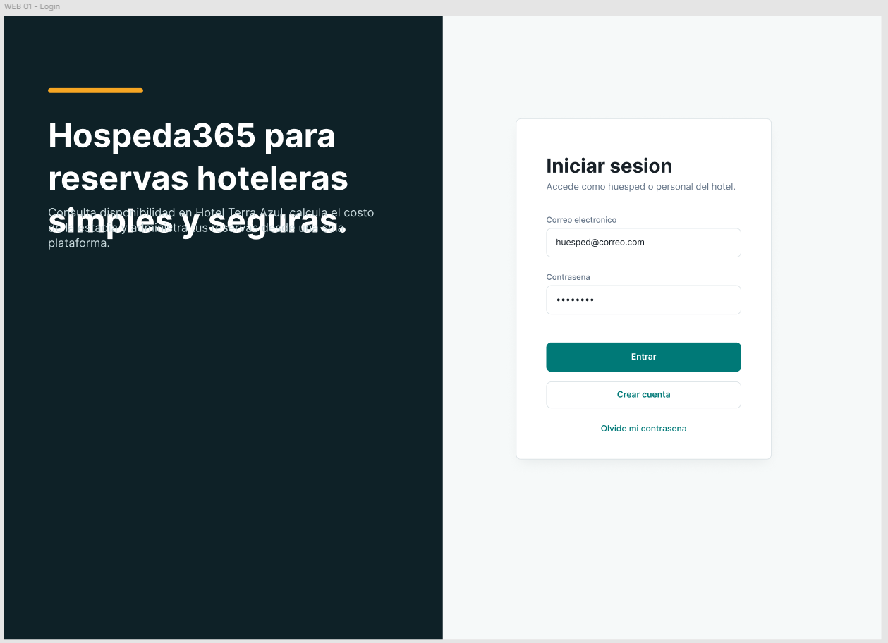
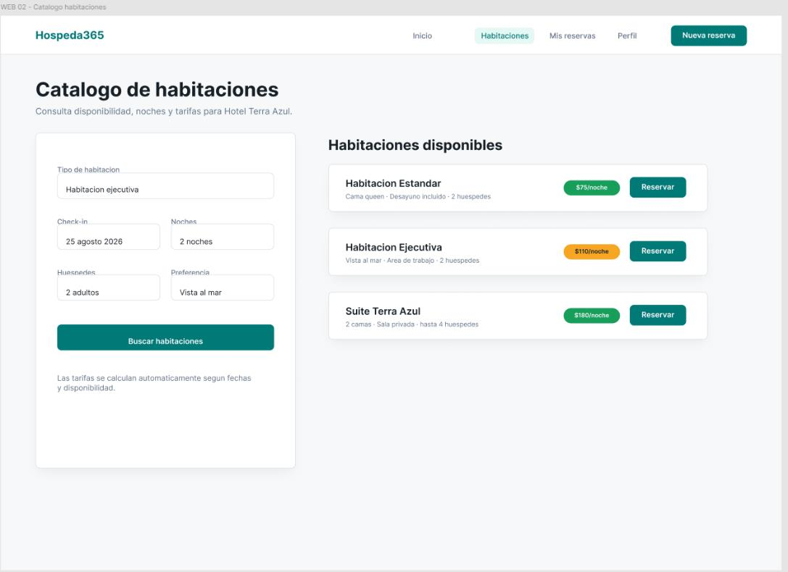
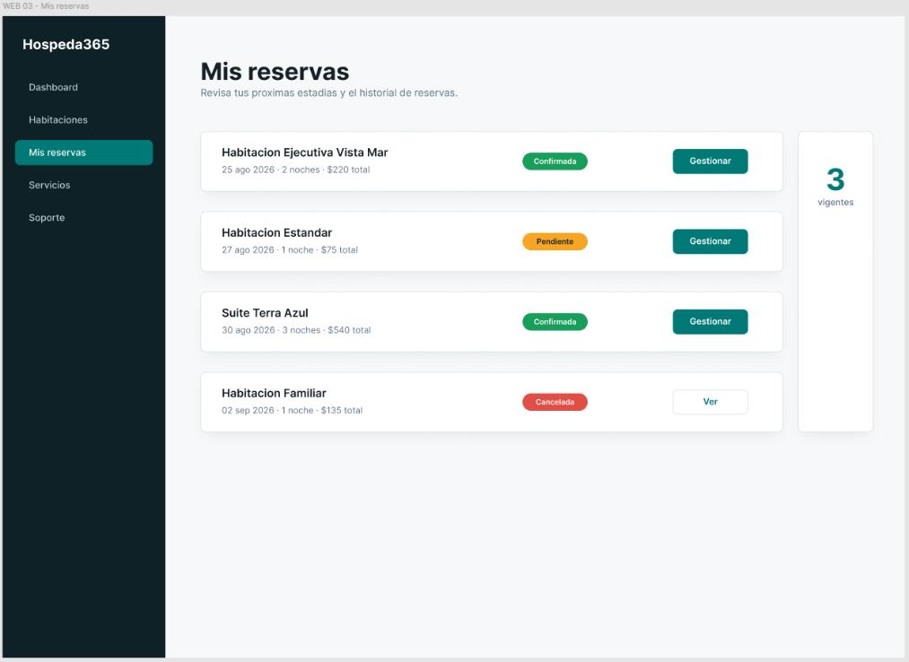
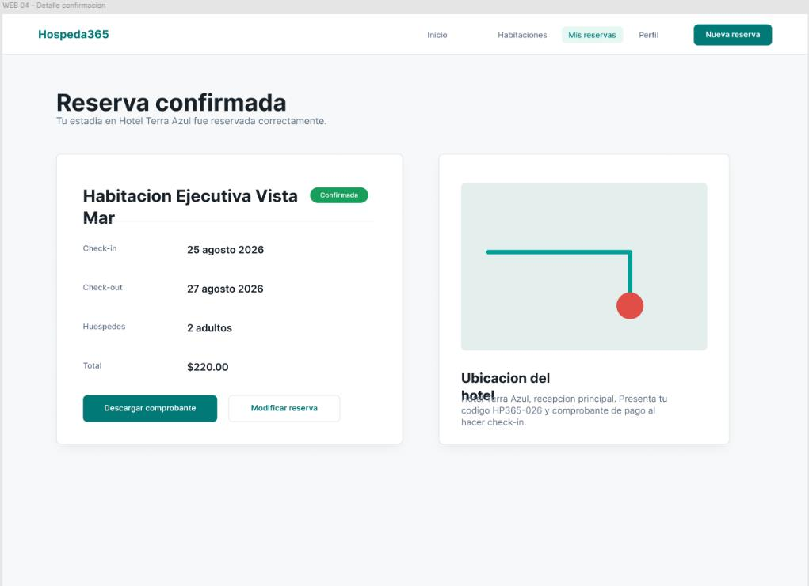

# Hospeda365 Web — Hotel Terra Azul

Plataforma web del **Hotel Terra Azul** impulsada por **Hospeda365**.  
Permite a los huéspedes explorar habitaciones, gestionar su cuenta y reservar, y al personal operar el panel administrativo de forma sincronizada en tiempo real con la aplicación móvil.

## Enlaces del Proyecto

* **Aplicación Web en Producción (Vercel):** [https://hospeda365-web.vercel.app/](https://hospeda365-web.vercel.app/)
* **Repositorio Aplicación Móvil (React Native):** [https://github.com/al3padilla/hospeda365-app](https://github.com/al3padilla/hospeda365-app)

---

## Stack

| Tecnología | Uso |
| --- | --- |
| **Next.js 16** | App Router y SSR |
| **React 19** | Interfaz |
| **TypeScript** | Tipado estático |
| **Tailwind CSS 4** | Estilos |
| **Firebase** | Auth (Correo y Google) + Cloud Firestore + Storage |
| **Lucide React** | Iconografía |

---

## Módulos y Sincronización Multiplataforma

* **Autenticación completa:** Registro e inicio de sesión mediante correo electrónico y **Google** con control de acceso por roles (`huésped` y `admin`).
* **Persistencia compartida en tiempo real:** Conexión directa con Cloud Firestore (`users`, `rooms` y `bookings`) sincronizada al instante con `hospeda365-app`.
* **Módulo del Huésped:** Catálogo de habitaciones disponibles, filtro por fechas y capacidad, cálculo automático de estadía, carga de comprobantes en Storage e historial *Mis Reservas*.
* **Panel Administrativo:** Dashboard con métricas dinámicas (ocupación, ingresos confirmados, por cobrar y ganancias mensuales), validación de comprobantes y gestión de estados de habitaciones.

---

## Mockups de Diseño (Etapa 1 - Figma)

[Consultar diseño original en Figma](https://www.figma.com/design/Ffof4DCOZYSizHP9uBn2H4/)

### Inicio de sesión

<p align="center">
  
</p>

### Catálogo de habitaciones

<p align="center">
  
</p>

### Gestión de reservas

<p align="center">
  
</p>

### Confirmación de reserva

<p align="center">
  
</p>

---

## Requisitos

- Node.js **20+**
- Proyecto Firebase con **Authentication** (Email/Password y Google), **Cloud Firestore** y **Storage** (compartido con `hospeda365-app`)
- Cuenta administradora en Firestore: `users/{uid}` con `rol: "admin"`

---

## Configuración

```bash
npm ci
npm run dev
```

Crea un archivo `.env.local` (excluido de Git) con las variables del proyecto Firebase:

```dotenv
NEXT_PUBLIC_FIREBASE_API_KEY=
NEXT_PUBLIC_FIREBASE_AUTH_DOMAIN=
NEXT_PUBLIC_FIREBASE_PROJECT_ID=
NEXT_PUBLIC_FIREBASE_STORAGE_BUCKET=
NEXT_PUBLIC_FIREBASE_SENDER_ID=
NEXT_PUBLIC_FIREBASE_APP_ID=
```

Los valores se obtienen en **Firebase Console → Project settings → Your apps**.

> Sin estas variables, la autenticación no estará disponible.

Abre [http://localhost:3000](http://localhost:3000) en desarrollo.

---

## Comandos

| Comando | Función |
| --- | --- |
| `npm run dev` | Servidor de desarrollo |
| `npm run lint` | Análisis estático |
| `npm run build` | Compilación de producción |
| `npm run start` | Servidor de producción |
| `npm run seed:firestore` | Migración idempotente de datos iniciales |

---

## Migración inicial

La migración carga seis habitaciones y nueve reservas desde `scripts/firestore.seed.json`.

Agrega temporalmente las siguientes variables a `.env.local`:

```dotenv
FIREBASE_SEED_EMAIL=
FIREBASE_SEED_PASSWORD=
```

La cuenta debe tener rol `admin` en Firestore. Ejecuta:

```bash
npm run seed:firestore
```

---

## Estructura

| Ruta | Responsabilidad |
| --- | --- |
| `app/` | Rutas y páginas |
| `components/` | Componentes visuales |
| `contexto/` | Estado global y suscripciones en tiempo real |
| `servicios/` | Firebase Auth y operaciones de Firestore |
| `datos/` | Tipos y utilidades puras |
| `scripts/` | Datos y script de migración |
| `docs/` | Especificación técnica y mockups de Figma |

---

## Firebase

```bash
firebase deploy --only firestore:rules,firestore:indexes
```

La definición de colecciones, permisos e índices está documentada en [docs/firebase-firestore.md](docs/firebase-firestore.md).

---

## Equipo de Desarrollo (EcoTech Solutions)

Integrantes:

- Alexander Ulises Elías Vásquez | EV210855
- Marlene Noemy López de Servando | LQ221481
- Jonathan Américo Merino Medina | MM221719
- Alexandra Guadalupe Padilla Ramírez | NR221019
- Jason Oswaldo Sosa Hernández | SH210738

---

## Licencia

Este proyecto está protegido bajo la licencia **Creative Commons Atribución-NoComercial-CompartirIgual 4.0 Internacional (CC BY-NC-SA 4.0)**.

[](http://creativecommons.org/licenses/by-nc-sa/4.0/deed.es)

Consulta el archivo [LICENSE](./LICENSE) para más detalles sobre los términos de uso.
